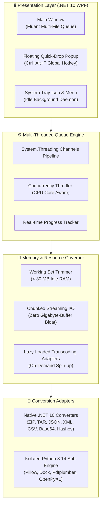

# 🔄 Universal File Converter & Editor (`FileForge`)
## Comprehensive System Architecture & Project Blueprint

> **Status**: ✅ Completed & Verified (Core Engine, Fluent UI, PPT/PDF, Format Browser, Win32 Hooks)  
> **Workspace**: `D:\Projects\File editor`  
> **Target Environment**: Windows 11 (x64) • .NET 10 (`dotnet 10.0.404`) • C# 14 • Python 3.14  
> **Design Language**: Windows 11 Fluent Mica/Acrylic (aligned with *TaskHub* & *TaskHubGreeter*)

---

## 1. 🎯 Project Overview & Core Goals

The **Universal File Converter & Editor** (`FileForge`) is a lightweight, ultra-responsive Windows desktop application engineered for both power users and engineers. It enables fast batch file conversions, deep file type/extension inspection, and seamless format transcoding across images, documents, spreadsheets, data files, and archives.

### User Requirements Addressed
1. **Multiple Files & Batch Processing**: Support selecting, dropping, or queuing 100+ files or entire directories at once, with bulk target format assignment (e.g. "Convert all images to WEBP", "Convert all CSVs to XLSX").
2. **Instant Shortcut Access**: Global hotkey (`Ctrl+Alt+F`) summons a sleek, floating drop-target launcher (inspired by *TaskHub*'s `LauncherWindow`), plus a silent system tray daemon.
3. **Minimal Memory Footprint (< 30 MB idle)**: Stream-based processing, lazy loading of heavy conversion engines, and process working-set trimming when idle or minimized.
4. **Clean, Fluent UI**: Crafted with the exact design language, brushes, and typography of your flagship projects (*TaskHub* and *TaskHubGreeter*), utilizing `Segoe Fluent Icons`, subtle border strokes, and dark/light adaptive styling.

---

## 2. ⚡ Architecture & Low-Memory Engineering



### Key Low-Memory Strategies
- **Stream-Based Chunking**: Files are converted using streaming buffers rather than loaded into monolithic byte arrays.
- **Lazy Adapter Invocations**: Native C# handles 80% of lightweight conversions (JSON, XML, CSV, Text, Zip, Base64, Hex). Heavyweight converters (Python Pillow, PDFium, Docx) run as isolated child worker processes that immediately terminate upon task completion, liberating all memory.
- **Aggressive Working Set Trimming**: When the application is hidden in the system tray or idle for > 60 seconds, Windows Win32 `SetProcessWorkingSetSize` is triggered, dropping RAM usage down to **< 20–30 MB**.
- **Self-Contained .NET 10 Native Trimming**: Compiled with aggressive IL trimming (`PublishTrimmed=true`, ReadyToRun) for instant startup and low runtime overhead.

---

## 3. ⌨️ Instant Shortcut & Access System

Modeled after the battle-tested architecture of `D:\Projects\TaskHub\src\TaskHub.Platform.Windows`:

1. **Global Hotkey Registration**:
   - Uses `RegisterHotKey` with a message-only `HwndSource` (`HWND_MESSAGE`).
   - Default Shortcut: **`Ctrl + Alt + F`** (fully customizable in Settings).
   - Pressing the hotkey instantly summons a floating, borderless **Quick-Drop Overlay** directly centered on the active screen.

2. **Quick-Drop Mini-Launcher**:
   - A minimalist, acrylic-shadowed pill window (identical in spirit to `TaskHub.App.LauncherWindow`).
   - Drop one or multiple files onto it -> Choose target format with 1 keystroke -> Converts in the background without opening the full window.
   - Shows a subtle progress ring and delivers a native Windows toast notification with a clickable "Open Output" button upon completion.

3. **System Tray Integration**:
   - `FileForge` can stay resident in the notification area.
   - Right-click menu: *Open Full Converter*, *Quick Convert Clipboard*, *Clear Completed*, *Settings*, *Exit*.
   - Closing the main window cleanly minimizes to tray if configured.

---

## 4. 🗂️ Multi-File & Batch Operations Matrix

### Batch Features
- **Multi-File Selection & Folder Drop**: Drag 50 files or drop a folder with sub-directories (with an option to flatten or preserve folder hierarchy in the output).
- **Uniform Batch Target Assignment**: One-click dropdown in the toolbar:
  - *"Set all images to: [ WEBP ▼ ]"*
  - *"Set all spreadsheets to: [ CSV ▼ ]"*
  - *"Set all docs to: [ PDF ▼ ]"*
- **Item-Specific Overrides**: Each row in the batch table still allows custom target formats and options.
- **Controlled Concurrency**: Bounded worker channels (`BoundedChannelOptions`) prevent CPU/RAM throttling even with hundreds of queued items.

| Category | Input Formats | Target Output Formats | Batch Capabilities |
|---|---|---|---|
| **🖼️ Images** | `PNG`, `JPG`/`JPEG`, `WEBP`, `BMP`, `ICO`, `TIFF`, `GIF` | `PNG`, `JPG`, `WEBP`, `BMP`, `ICO`, `PDF`, `TIFF` | Batch resize, quality slider (1-100%), bulk convert to PDF booklet |
| **📄 Documents & Text** | `DOCX`, `PDF`, `TXT`, `MD`, `HTML` | `PDF`, `DOCX`, `TXT`, `MD`, `HTML` | Batch PDF text extraction, bulk Markdown -> HTML/PDF |
| **📊 Spreadsheets** | `CSV`, `XLSX`, `TSV` | `CSV`, `XLSX`, `JSON`, `HTML Table` | Multi-file delimiter normalizer, CSV <-> Excel batch |
| **💻 Data & Config** | `JSON`, `XML`, `YAML`, `CSV` | `JSON`, `XML`, `YAML`, `CSV` | Batch minify, pretty-print, schema re-formatting |
| **🔒 Encoding & Hashes** | `Base64`, `Hex`, `Binary`, `Text` | `Base64`, `Hex`, `Plain Text`, Hash (`MD5`/`SHA-256`) | Mass checksum generator, bulk decode/encode |
| **📦 Archives** | `ZIP`, `TAR`, `GZ` | `ZIP`, `TAR`, `GZ`, Unpacked Folder | Batch zip compression or archive extraction |

---

## 5. 🎨 UI/UX Design (Matching TaskHub's Clean Aesthetic)

Utilizes the exact design tokens and typography from `D:\Projects\TaskHub`:
- **Palette**: Windows 11 Fluent Dark Theme with `SolidBackgroundFillColorBaseBrush`, `LayerFillColorAltBrush`, and `CardStrokeColorDefaultBrush`.
- **Typography**: `Segoe UI Variable Display`, `Segoe UI Variable Text`, with `Segoe Fluent Icons` for symbols.
- **Layout**: Clean left compact navigation rail (Convert, Batch, Inspector, Settings) with rounded card containers (`CornerRadius="8"`).

### Main Window Layout
```
+---------------------------------------------------------------------------------------------------+
|  [🔄 FileForge]                                                       [ ⚙️ ]  [ — ] [ 口 ] [ ✕ ] |
+----+----------------------------------------------------------------------------------------------+
| ≡  |  📂 DROP MULTIPLE FILES OR FOLDERS HERE                                                      |
|    |  (or click Browse Files / Browse Folder)                                                     |
| C  +----------------------------------------------------------------------------------------------+
| O  |  📋 Batch Queue: 4 files loaded | 1.8 MB total                     [ 🗑️ Clear ] [ ➕ Add More ] |
| N  +----+--------------------------+-----------+------------+-------------------------+-----------+
| V  | ☑  | File Name                | Detected  | Target To  | Options                 | Status    |
| E  +----+--------------------------+-----------+------------+-------------------------+-----------+
| R  | ☑  | render_01.png            | PNG Image | [ WEBP ▼ ] | Quality: 85%            | [ Ready ] |
| T  | ☑  | render_02.png            | PNG Image | [ WEBP ▼ ] | Quality: 85%            | [ Ready ] |
|    | ☑  | data_log.csv             | CSV Data  | [ XLSX ▼ ] | Include Headers: Yes    | [ Ready ] |
| B  | ☑  | architecture.docx        | Word Doc  | [ PDF  ▼ ] | High DPI text           | [ Ready ] |
| A  +----+--------------------------+-----------+------------+-------------------------+-----------+
| T  |  ⚡ Batch Actions: [ Apply Target to Selected: [ WEBP ▼ ] [ Apply ] ]                          |
| C  |  📂 Output Directory: [ D:\Projects\File editor\output                  ] [ Change ]          |
| H  |  Progress: [====================================................] 75%                       |
|    |  [ 🔍 Inspect Selected ]                              [ 🚀 CONVERT ALL (4 FILES) ]           |
+----+----------------------------------------------------------------------------------------------+
| 🟢 Ready | 24 MB RAM | Shortcut: Ctrl+Alt+F | Background Daemon Active                            |
+---------------------------------------------------------------------------------------------------+
```

### Floating Quick-Launcher Overlay (`Ctrl+Alt+F`)
```
       +----------------------------------------------------------------------+
       |  🔄  FileForge Quick-Drop                     [ Ctrl+Alt+F to close ]|
       |  +----------------------------------------------------------------+  |
       |  |     Drop files here to quickly convert to: [ WEBP ▼ ]         |  |
       |  +----------------------------------------------------------------+  |
       |  Last converted: schematic.png -> schematic.webp (saved to output)   |
       +----------------------------------------------------------------------+
```

---

## 6. 📂 Solution Structure & Modular Organization

```
D:\Projects\File editor\
├── src\
│   ├── FileForge.Core\                 # Conversion contracts, memory-efficient streams
│   │   ├── Models\
│   │   │   ├── ConversionBatch.cs      # Batch queue manager with cancellation
│   │   │   ├── ConversionItem.cs       # Per-file properties, target format, options
│   │   │   └── FileTypeSignature.cs    # Magic bytes signature database
│   │   ├── Interfaces\
│   │   │   ├── IFileConverter.cs       # Core conversion interface
│   │   │   └── IBatchPipeline.cs       # Channel-based worker pipeline
│   │   ├── Converters\
│   │   │   ├── ImageConverter.cs       # Fast image transcoder
│   │   │   ├── DocumentConverter.cs    # Text/Markdown/HTML/Docx/PDF bridge
│   │   │   ├── DataConverter.cs        # CSV, XLSX, JSON, XML
│   │   │   ├── ArchiveConverter.cs     # ZIP, TAR, GZ streaming
│   │   │   └── DevConverter.cs         # Base64, Hex, Checksum
│   │   └── Registry\
│   │       └── ConverterRegistry.cs    # Dynamic type discovery & routing
│   │
│   ├── FileForge.Platform.Windows\     # Reusable Win32 interop (hotkeys, tray, memory trim)
│   │   ├── Hotkeys\
│   │   │   └── WindowsHotkeyService.cs # RegisterHotKey via HWND_MESSAGE
│   │   ├── SystemTray\
│   │   │   └── TrayIconController.cs   # Windows NotifyIcon & context menu
│   │   └── Memory\
│   │       └── MemoryOptimizer.cs      # SetProcessWorkingSetSize & GC governor
│   │
│   ├── FileForge.Adapters.Python\      # Lightweight on-demand Python CLI bridges
│   │   ├── converter_cli.py            # Minimal footprint runner (Pillow, Docx, PDF)
│   │   └── requirements.txt            # Pre-installed packages
│   │
│   └── FileForge.App\                  # .NET 10 WPF Application Shell
│       ├── App.xaml / App.xaml.cs      # Application startup, tray daemon, themes
│       ├── MainWindow.xaml             # Clean TaskHub-style primary window
│       ├── QuickLauncherWindow.xaml    # Floating shortcut overlay (Ctrl+Alt+F)
│       ├── ViewModels\
│       │   ├── MainViewModel.cs        # Batch state, items, commands
│       │   └── ItemViewModel.cs        # Item-level progress, target options
│       └── Assets\
│           └── FileForge.ico           # Application & tray icon
│
├── build.cmd                           # Fast build command
├── build.ps1                           # Release publish script (single-file exe)
└── README.md                           # Documentation & usage manual
```

---

## 7. 🚀 Implementation Roadmap

1. **Step 1: Scaffolding & Foundation**
   - Create .NET 10 Solution (`FileForge.sln`) with `FileForge.Core`, `FileForge.Platform.Windows`, and `FileForge.App`.
   - Setup Git `.gitignore` matching project conventions.

2. **Step 2: Windows Platform & Shortcut Integration**
   - Implement `WindowsHotkeyService` for `Ctrl+Alt+F`.
   - Implement `MemoryOptimizer` (working set trimmer for < 30 MB idle RAM).
   - Setup System Tray manager.

3. **Step 3: Multi-File Batch Conversion Engine**
   - Implement `IBatchPipeline` with `System.Threading.Channels`.
   - Implement streaming format converters (Images, Documents, Data, Archives, Dev).
   - Hook Python helper script for Docx/PDF/Pillow conversions.

4. **Step 4: Clean TaskHub-Inspired WPF UI**
   - Build `MainWindow.xaml` with Drag & Drop Multi-file DataGrid, batch actions bar, and progress indicators.
   - Build `QuickLauncherWindow.xaml` (borderless floating drop target).
   - Wire MVVM bindings, cancellation, and error handling.

5. **Step 5: Verification & Packaging**
   - Test batch conversion of mixed file types.
   - Verify RAM stays under 30 MB when idle in tray.
   - Test `Ctrl+Alt+F` hotkey activation.
   - Build single-file executable.

---

## 8. 🚦 Ready for Your Go-Ahead

> The blueprint has been updated with:
> - **Batch / Multi-file conversion queue**
> - **Global Hotkey (`Ctrl+Alt+F`) & Quick-Launcher overlay**
> - **Ultra-low memory governor (< 30 MB idle)**
> - **Clean UI matching *TaskHub***
>
> Say **"Proceed"** to begin building!
