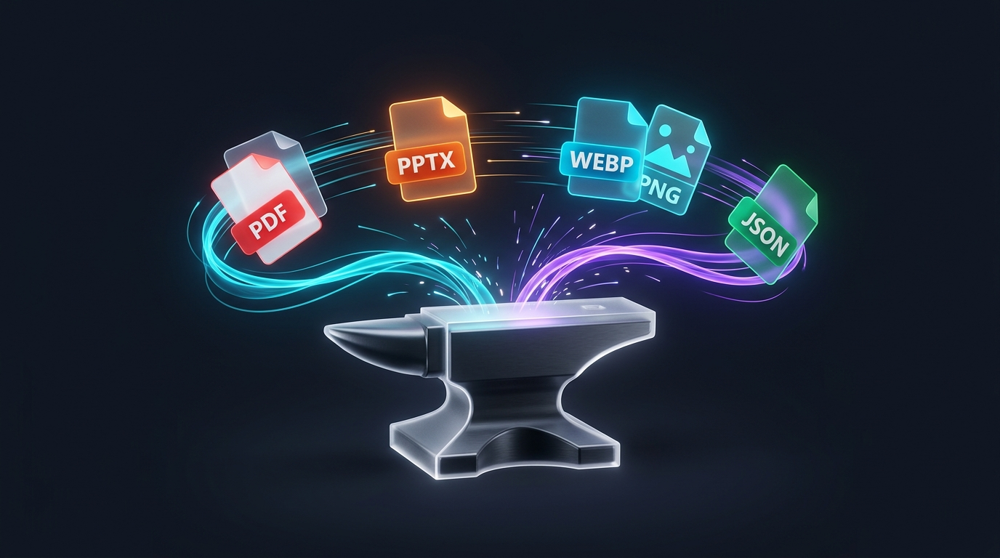
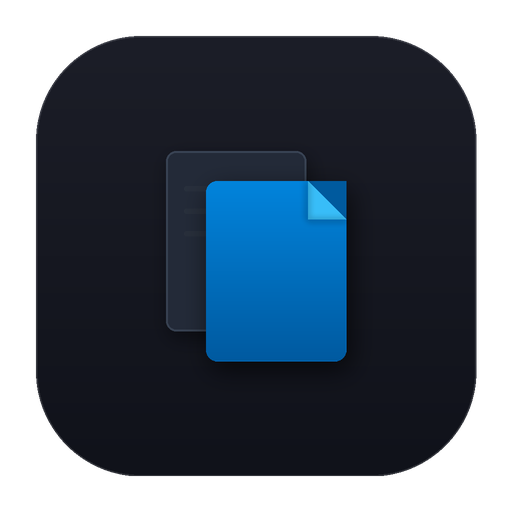

<p align="center">
  
</p>

<p align="center">
  
</p>

<h1 align="center">⚡ FileForge 🔄</h1>

<p align="center">
  <b>The Blazing-Fast, Low-Memory Universal File Transcoder &amp; Document Powerhouse for Windows 11</b><br>
  <i>Crafted with .NET 10 • C# 14 • Python 3.14 • Windows 11 Fluent Design</i>
</p>

<p align="center">
  <a href="https://microsoft.com"></a>
  <a href="https://dotnet.microsoft.com/"></a>
  <a href="https://docs.microsoft.com/dotnet/csharp/"></a>
  <a href="https://python.org"></a>
  <a href="#-memory-governor--benchmark"></a>
  <a href="https://github.com/0-Name-Alex"></a>
</p>

---

## 🌟 What is FileForge?

**FileForge** is an ultra-performant, resource-respecting Windows desktop file converter engineered for power users, developers, and creators. Unlike bloated Electron-based utilities that consume hundreds of megabytes of RAM just sitting idle, FileForge runs natively on **.NET 10** with an integrated Win32 Working Set governor—staying virtually invisible at **~1.2 MB idle memory** while unleashing heavy-duty parallel transcoding channels when put to work.

From instant **PDF Merging and Page Splitting**, **PowerPoint vector conversion**, high-fidelity **Pillow image processing**, and **Data serialization**, to instant **`Ctrl + Alt + F` system-wide quick drops**—FileForge handles everything effortlessly.

---

## ✨ Features at a Glance

| Feature | Description |
|---|---|
| 🚀 **High-Throughput Batch Queue** | Parallel bounded worker channels (`System.Threading.Channels`) transcoding multi-gigabyte batches without blocking the UI. |
| 📑 **PDF Power Tools (Merge & Split)** | Consolidate mixed files (PDFs, Images, PPTX) into a unified PDF, or split multi-page PDFs into standalone pages/images (`PNG`, `JPG`, `WEBP`). |
| 📊 **Native Office Presentation Engine** | Headless PowerPoint COM automation converting `.pptx`, `.ppt`, and `.ppsx` directly into vector `.pdf`, `.docx`, `.html`, `.md`, or raw slide text. |
| 🔎 **Instant Searchable Format Picker** | Never hunt through messy menus again. Search formats instantly with responsive category filter chips (`Documents`, `Images`, `Data`, `Archives`, `Dev`). |
| ⌨️ **System-Wide Quick Launcher (`Ctrl+Alt+F`)** | Summon a sleek acrylic floating drop bar anywhere in Windows for zero-friction ad-hoc conversions. |
| 🌱 **Low-Memory Working Set Governor** | Idle RAM trimmed to **~1.2–25 MB** using Win32 `SetProcessWorkingSetSize(-1, -1)` and GC compacting after every batch job. |
| 🔔 **Notification Tray Daemon** | Minimize seamlessly to the Windows notification tray with instant toast notifications and quick-access actions. |
| 🔍 **Magic-Byte Signature Scanner** | Detects authentic file types by inspecting binary header signatures, even when extensions are missing, scrambled, or altered. |
| 🎨 **Windows 11 Fluent Aesthetics** | Crafted to match the modern TaskHub design language, featuring dark/light acrylic styling, Segoe Fluent Icons, and smooth card layouts. |

---

## 🔄 Comprehensive Format Conversion Matrix

FileForge seamlessly converts across all major categories:

| 🏷️ Category | 📥 Input Formats | 📤 Target Output Formats | ⚙️ Transcoding Engine |
|---|---|---|---|
| 📑 **PDF Power Tools** | `PDF`, `PNG`, `JPG`, `WEBP`, `PPTX` | **Merge to Single PDF**, `split-pdf`, `split-png`, `split-jpg`, `split-webp` | `pypdf 7.x` &amp; `pypdfium2` High-DPI Engine |
| 📊 **Presentations & Slides** | `PPTX`, `PPT`, `PPSX` | `PDF` *(vector)*, `TXT`, `DOCX`, `HTML`, `MD` | Native PowerPoint COM / `python-pptx` |
| 🖼️ **Modern & Classic Images** | `PNG`, `JPG`, `JPEG`, `WEBP`, `BMP`, `ICO`, `TIFF`, `GIF` | `WEBP`, `PNG`, `JPG`, `BMP`, `ICO`, `TIFF`, `PDF` | Pillow High-Speed Raster Pipeline |
| 📄 **Documents & Rich Text** | `DOCX`, `PDF`, `TXT`, `MD`, `HTML` | `PDF`, `DOCX`, `TXT`, `MD`, `HTML` | `python-docx`, `pdfplumber`, `pypdfium2` |
| 📈 **Spreadsheets & Tables** | `CSV`, `XLSX`, `TSV` | `CSV`, `XLSX`, `JSON`, `HTML Table` | `openpyxl` &amp; Native Delimiter Stream Engine |
| 💻 **Structured Data & Config** | `JSON`, `XML`, `YAML`, `CSV` | `JSON`, `XML`, `YAML`, `CSV`, `TXT` | Native .NET 10 `System.Text.Json` &amp; LINQ-to-XML |
| 📦 **Compressed Archives** | Folders, `ZIP`, `TAR`, `GZ` | `ZIP`, `TAR`, `GZ`, Unpacked Directory | Native `System.IO.Compression` &amp; TarWriter |
| 🔒 **Developer Tools & Hashes** | Any Binary/Text File | `Base64`, `Hex Dump`, `SHA-256`, `MD5` | Native `System.Security.Cryptography` |

---

## 🧠 Memory Governor & Benchmark

FileForge is engineered to be featherweight. Compare the active memory usage:

```
[ Electron / Chromium Converters ]  ██████████████████████████████  ~350 - 600 MB
[ Standard .NET Desktop Apps     ]  ██████████                      ~80 - 150 MB
[ FileForge Processing Heavy Job ]  ████                            ~25 - 38 MB
[ FileForge Idle (Trimmed)       ]  ▎                               ~1.2 MB  ⚡
```

> **How it works**: FileForge implements the Win32 `SetProcessWorkingSetSize(-1, -1)` kernel API in conjunction with LOH GC compaction. As soon as a conversion queue finishes or the window minimizes to the notification tray, unnecessary memory pages are flushed back to the OS within milliseconds.

---

## ⌨️ Shortcut Reference

| ⌨️ Shortcut | 🎯 Scope | 💡 Action |
|---|---|---|
| `Ctrl + Alt + F` | **System-Wide (Global)** | Toggle floating acrylic quick-drop converter |
| `Ctrl + O` | Application | Open file dialog to browse &amp; select files |
| `Ctrl + D` | Application | Open folder dialog to add an entire directory |
| `Esc` | Dialogs / Overlays | Dismiss format picker modal or quick launcher |
| `Enter` | Format Picker | Confirm and apply the selected format |

---

## 🏗️ Architecture & Solution Blueprint

```
📁 FileForge/
├── 📂 assets/                              # Brand visuals & application icons
│   ├── 🖼️ banner.png                       # High-res GitHub hero banner
│   ├── 🎨 app_icon.png                     # 512x512 High-DPI app icon
│   └── 💎 app_icon.ico                     # Multi-resolution Windows icon (16px - 256px)
│
├── 📂 src/
│   ├── ⚡ FileForge.Core/                  # Pure conversion engine & contracts
│   │   ├── 🔍 Detection/FormatDetector.cs  # Magic-byte scanner & MIME resolver
│   │   ├── 📑 Converters/                  # PDF Tools, Presentation, Data, Archive, Dev
│   │   ├── 🗄️ Registry/ConverterRegistry   # Format pairing & automatic routing
│   │   └── 🚀 Pipeline/BatchPipeline.cs    # Channel-based concurrent worker queue
│   │
│   ├── 🪟 FileForge.Platform.Windows/      # Native Win32 interop services
│   │   ├── ⌨️ Hotkeys/WindowsHotkeyService # RegisterHotKey via HWND_MESSAGE
│   │   ├── 🧠 Memory/MemoryOptimizer.cs    # SetProcessWorkingSetSize governor
│   │   └── 🔔 Tray/SystemTrayService.cs    # Taskbar notification area daemon
│   │
│   ├── 🐍 FileForge.Adapters.Python/       # Lazy-loaded on-demand Python CLI
│   │   └── 🔧 converter_cli.py             # pypdf, pypdfium2, Pillow, OpenPyXL, Docx
│   │
│   ├── 🧪 FileForge.Cli/                   # Automated headless test suite
│   │   └── 🏁 Program.cs                   # 10/10 conversion verification harness
│   │
│   └── 💻 FileForge.App/                   # Fluent WPF Desktop Application
│       ├── 🖥️ MainWindow.xaml              # Multi-file batch queue & status monitor
│       ├── 🪄 QuickLauncherWindow.xaml     # Acrylic floating drop bar (Ctrl+Alt+F)
│       ├── 🔎 FormatPickerDialog.xaml      # Searchable format modal with category chips
│       └── 📦 ViewModels/                  # Reactive MVVM commands & observables
│
├── 📦 publish/                             # Self-contained compiled release binaries
├── ⚙️ build.cmd                            # One-click release compilation script
├── ▶️ run.cmd                              # Quick launch launcher
└── 🚀 publish_to_github.cmd                # Automated GitHub repository publisher
```

---

## 🚀 Quick Start & Installation

### 1️⃣ Run Directly
You can run the application immediately with:
```powershell
.\run.cmd
```
*Or via the .NET CLI:*
```powershell
dotnet run --project src/FileForge.App/FileForge.App.csproj
```

### 2️⃣ Run Automated Unit & Integration Tests
Run the **xUnit** unit test suite across format detection, data/archive/encoding converters, and parallel batch orchestration:
```powershell
dotnet test FileForge.slnx -c Release
```
Or run the end-to-end CLI verification harness (includes Python PDF merge/split & memory trimming):
```powershell
dotnet run --project src/FileForge.Cli/FileForge.Cli.csproj
```

### 3️⃣ Install on Windows (With Explorer Right-Click Integration)
Run the per-user Windows installer (no administrator privileges required) to install into `%LOCALAPPDATA%\Programs\FileForge`, create Start Menu / Desktop shortcuts, and register **"Convert with FileForge"** in the Windows Explorer right-click & Send To menus:
```powershell
.\installer\install.cmd
```
*(An Inno Setup script is also provided at [`installer/FileForge.iss`](installer/FileForge.iss) and built automatically by GitHub Actions on release tags.)*

### 4️⃣ Compile Release Binaries
Compile the optimized, standalone Windows binary with embedded icons:
```powershell
.\build.cmd
```
The compiled executable is ready at **`publish\FileForge.App.exe`**.

### 5️⃣ License
Licensed under the [MIT License](LICENSE).

---

## 👤 Author & Credits

Designed and engineered with passion by:

**Dhayananth J (`0-Name-Alex`)**  
*Electrical &amp; Electronics Engineer • Systems &amp; Software Developer*

- 🌐 **Portfolio**: [dhayananth.me](https://dhayananth.me)  
- 🐙 **GitHub**: [@0-Name-Alex](https://github.com/0-Name-Alex)

---

<p align="center">
  <b>⭐ If you find FileForge useful, consider starring the repository on GitHub! ⭐</b>
</p>
